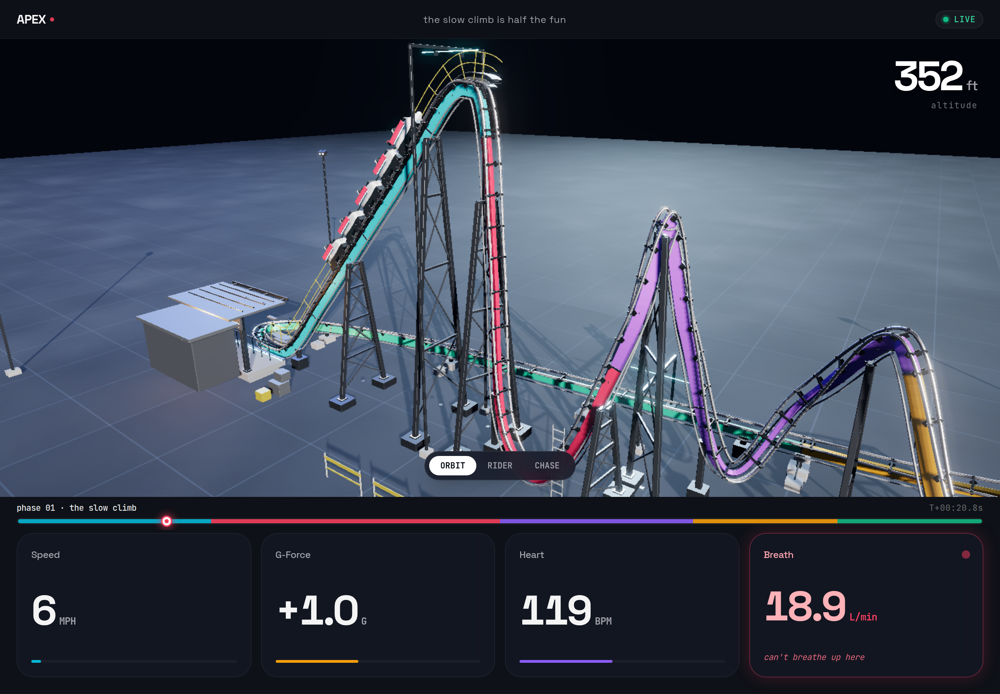
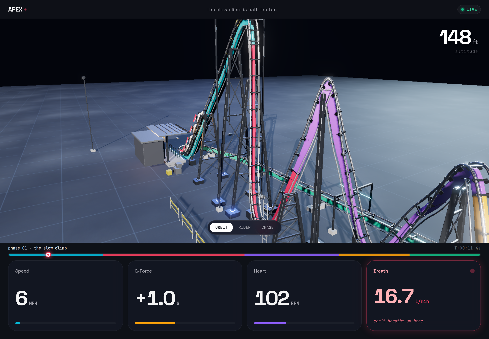
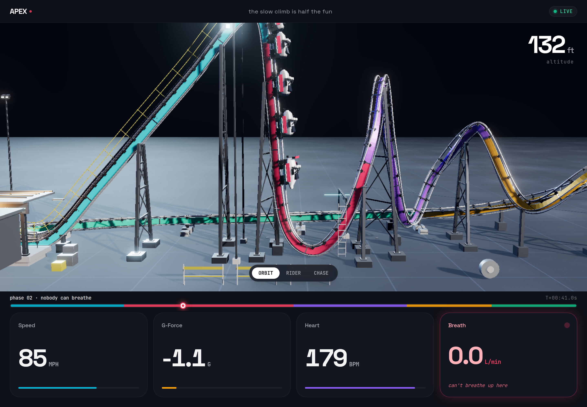
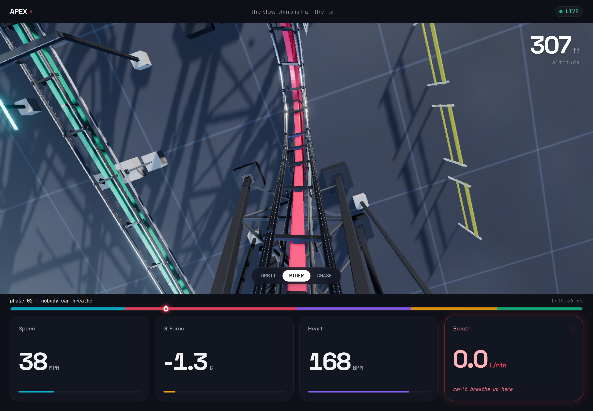
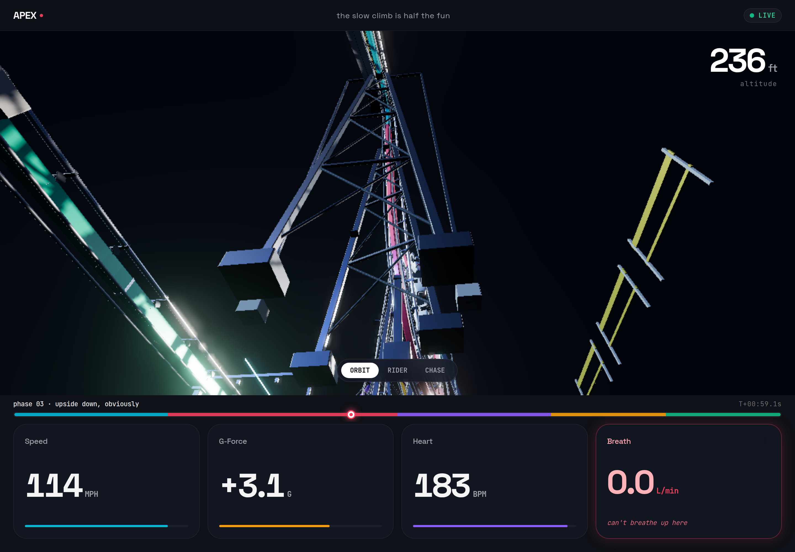
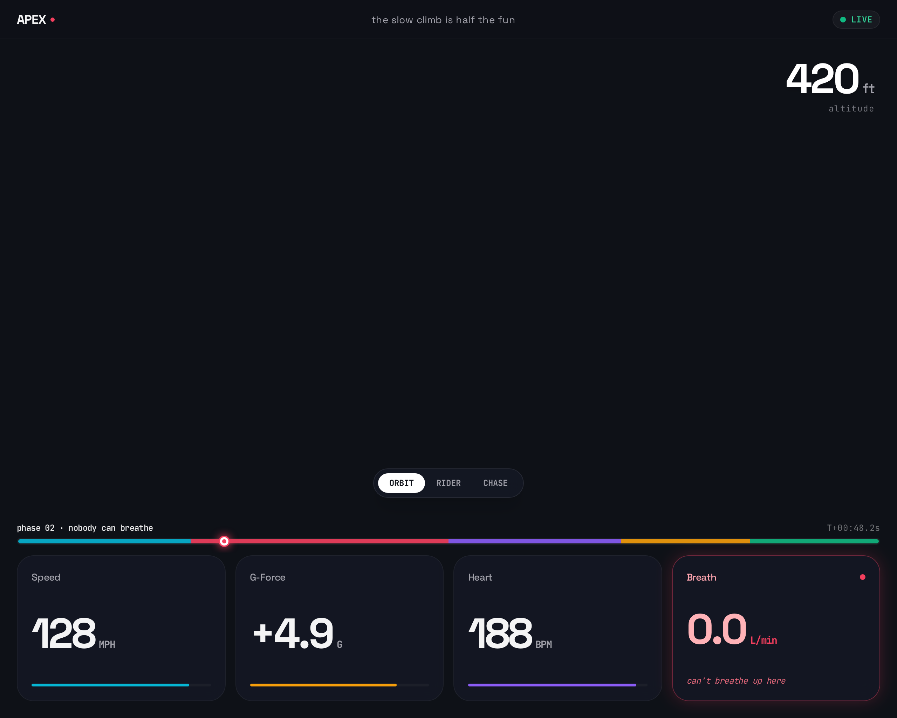

<div align="center">

# APEX // Hyper-Coaster Telemetry

**A real-time 3D roller-coaster telemetry cockpit — Blender-baked geometry, Stitch-designed UI, live-synced at 60 fps.**

[](https://andrewmason7.github.io/apex-coaster-telemetry/)
[](https://github.com/AndrewMason7/apex-coaster-telemetry)

[](https://threejs.org)
[](https://www.blender.org)
[](https://stitch.withgoogle.com)
[](#)
[](#design-system)
[](LICENSE)

[](#track-geometry)
[](#how-it-works)
[](#how-it-works)
[](#controls)
[](#run-it)

`188,272 triangles` · `560 telemetry frames` · `5 articulated cars` · `3 camera modes` · `7 numbers on screen`

</div>

---

> *"The slow climb is half the fun, and the other half is the part where nobody can breathe."*

APEX is a 3D-first page for a fictional hyper-coaster. The scene is built from a Blender-authored
`.glb` and takes roughly two thirds of the viewport; underneath it sit four numbers and a timeline.
Everything is driven by the **same** 560-frame kinematic sidecar, so each readout is a function of
where the train physically is on the track — not a canned animation.

The page deliberately carries **seven values, not seventy**. The density is the design: a big
stage, one altitude, four stats, a phase name and a clock.

|  |
|:---:|
| *The full cockpit: live WebGL stage above, 560-frame telemetry deck below* |

|  |
|:---:|
| *Orbit 3D — the 45° chain lift, catwalk and A-frame support towers* |

|  |  |
|:---:|:---:|
| *Side profile — the 89.5° plunge into the glowing tunnel portals* | *Rider POV — hanging over the 420 ft crest, banked camera up-vector* |

|  |  |
|:---:|:---:|
| *Chase cam — five articulated cars banking into the teardrop loop* | *The Stitch-generated cockpit layout, before the 3D stage was mounted* |

---

## The ride

Five phases, each with its own colour identity, its own materials, and its own physiology:

| # | Phase | Colour | What actually happens | Peak readout |
|---|---|---|---|---|
| 01 | **The Slow Climb** | Cyan `#06B6D4` | 45° chain lift, 420 ft, lap-bar clench rising | `6.4 mph` · `+87% grip` |
| 02 | **Zero-Breath Drop** | Crimson `#F43F5E` | 89.5° beyond-vertical, then the pullout trench | `128.4 mph` · `+4.92 G` · `0.0 L/min` |
| 03 | **Teardrop Loop & Roll** | Violet `#8B5CF6` | Inverted apex into a banked zero-G roll | `-64° → +68° bank` |
| 04 | **−1.4 G Ejector Airtime** | Amber `#F59E0B` | Camelback crest with real ejector airtime | `−1.80 G` measured |
| 05 | **Magnetic Fin Brake Run** | Emerald `#10B981` | Eddy-current deceleration back to station | `82 → 6.4 mph` |

Measured extremes across all 560 frames: **420.8 ft** max altitude, **128.4 mph** max speed,
**+4.92 G / −1.80 G** vertical G range, **188 bpm** peak heart rate, **114.8 dB** peak scream
register, **0.0 L/min** minimum respiration.

---

## How it works

```
blender/build_coaster.py
      │
      │  28 control points → periodic Catmull-Rom spline
      │  → 560 samples of position + tangent + banked side + normal
      │
      ├──► assets/apex_coaster.glb        (83,833 faces → 188,272 triangles, 17 objects, 27 PBR materials)
      └──► assets/apex_telemetry.json     (560 frames × kinematics + biometrics)
                    │
                    ▼
            index.html  ── Three.js r170 + PMREM studio env + shadow map + selective bloom
                    │
                    └──► bottom deck: every card is bound to the frame index
```

**The spline is closed and periodic.** The train never teleports: sample `559` interpolates back
into sample `0`, so the loop is continuous in position, tangent **and** roll. The bank angle is a
fourth Catmull-Rom channel evaluated on the same parameter, which is why the train leans into the
overbanked turn instead of sliding through it flat.

**Orientation is a proper basis, not a `lookAt`.** Each frame exports `tan`, `up` and `side`; the
renderer re-orthogonalises them with Gram-Schmidt and builds a rotation matrix
`makeBasis(tan, up, side)`. That is what lets the rider-POV camera roll upside down through the
loop without gimbal artefacts.

**Five cars, five spline offsets.** Each car samples the spline at `leadT − i·0.0145`, so the consist
articulates around crests exactly like a real train.

---

## Track geometry

| Component | Detail |
|---|---|
| Track spine | 0.17 × 0.40 m chamfered box girder swept on the banked frame, painted per phase, with proud splice bands every 6 m |
| Running rails | Two 16-sided polished steel tubes (r 52 mm) with worn contact strips and adjustable clamp blocks bolted through every tie |
| Crossties | Chamfered steel plates every ~0.86 m, four hex bolts + gusset plates per tie, Warren diagonal rods down to the delta chords |
| Delta chords | Two 10-sided galvanised lower tubes carrying the truss load path |
| Support towers | Lattice A-frames: 190 mm chamfered legs, three rungs, X-bracing with gussets, bolted saddle clamps, 860 mm chamfered concrete footings |
| Chain lift | Twin-plate chain trough, alternating link plates on a 0.30 m pitch, drive sprocket and housing at the lift base |
| Catwalk | Lift-hill grating with slats, twin handrails, posts every ~1.5 m and a toe board |
| Station | Platform deck with nosing and tactile strip, canopy on 215 mm columns, roof purlins, glazed building, extruded `APEX` fascia lettering, queue rails |
| Ground kit | Floodlight masts with fixtures, sensor gantries with emissive strips, barriers, crates, cable reel, maintenance ladder |
| Train | Sculpted lofted shell with nose, windscreen, side pods, headrest fairings, OTSR tubes, lap bars, spoiler, bogie side plates, road/upstop/side-friction wheels with flanges and LED trim |

---

## Run it

No build step, no bundler — it is one HTML file plus two assets.

```bash
python3 -m http.server 8791
# open http://127.0.0.1:8791/
```

A plain `file://` open will not work: the GLB is fetched with `fetch()`, which browsers block
across the file protocol.

### Controls

| Control | Effect |
|---|---|
| Drag the 3D stage | Orbit the camera (theta / phi) |
| `ORBIT` | Free orbit (drag the stage to rotate) |
| `RIDER` | Eye point on the lead car, camera up-vector follows the bank |
| `CHASE` | 10.5 m behind, 4.6 m up, looking past the consist |
| *side profile* | Deep-link only: `?cam=SIDE` |
| Timeline strip | Click anywhere to jump the train and every readout to that frame |

The page also exposes a deterministic hook for headless capture:

```js
window.apexStepSimulation(0.268, 'RIDER_POV');  // freeze + seek + re-render
window.apexScrubTo(0.50);
window.apexSetCamera('CHASE_CAM');
window.__coasterLoaded;                          // true once the GLB is in the scene
```

Any frame can also be deep-linked, which is how `screenshots/` was captured:

```
?t=0.275&cam=RIDER_POV&dpr=2          # freeze at a spline position, retina capture
?t=0.02&cam=FREE&px=-13&py=4&pz=9&tx=-17.9&ty=1.8&tz=1.2&fov=52
```

`?t=` also pins quality (the adaptive ladder is disabled) so captures are reproducible.

---

## Rebuilding the asset

Requires Blender 4.x/5.x with the Python API. `blender/build_coaster.py` is self-contained: it
clears the scene, builds every material, sweeps the track, places the towers, generates the five
cars, exports the GLB and writes the telemetry sidecar.

```bash
blender --background --python blender/build_coaster.py
# → /tmp/apex_coaster.glb  +  /tmp/apex_telemetry.json
```

The script prints its own manifest, e.g. `APEX_MANIFEST {"faces": 83833, "tris": 196088, "objects": 17, ...}`.

`blender/render_studio_stills.py` is an optional offline path that sets up a Cycles studio with
area lights for high-resolution stills — useful if you want marketing frames rather than the
live WebGL view.

`scripts/build_live_app.py` regenerates `index.html` by injecting a Three.js runtime into the
Stitch-generated cockpit layout and binding the telemetry deck's element IDs.

---

## Design system

`design/DESIGN.md` is a full token sheet in the `@google/design.md` format — colours, typography,
radii, spacing and component specs.

```bash
npx -y @google/design.md lint design/DESIGN.md   # 0 errors, 0 warnings
```

Every phase owns an accent. The UI never invents a colour that the 3D scene does not use, which is
why the deck and the track read as one instrument rather than two pasted halves.

---

## Repo layout

```
.
├── index.html                     # the whole app
├── assets/
│   ├── apex_coaster.glb           # 83,833 faces → 188,272 triangles, 6.3 MB
│   └── apex_telemetry.json        # 560-frame kinematic + biometric sidecar
├── design/
│   ├── DESIGN.md                  # design tokens (lint-clean)
│   └── stitch-ui-render.png       # Stitch-generated layout
├── blender/
│   ├── build_coaster.py           # geometry + spline + GLB + sidecar
│   └── render_studio_stills.py    # optional Cycles studio renderer
├── scripts/
│   └── build_live_app.py          # injects the WebGL runtime into the Stitch layout
└── screenshots/
```

---

## Notes & limits

- The ride is fictional. The physics are *plausible*, not simulated: G-force, heart rate and
  respiration are authored curves sampled per frame, not outputs of a rigid-body solver.
- `apex_telemetry.json` is the single source of truth. If you change the spline, regenerate the
  sidecar too — the renderer trusts the sidecar for orientation, so a stale sidecar will drive the
  train through the track.
- Quality is adaptive: if the live frame rate sits under ~52 fps the stage first trims the pixel
  ratio, then drops the bloom pass. Fixed captures (`?t=`) never adapt.
- Tested in Chromium and Safari. The stage renders through an MSAA render target, a 2048² PCFSoft
  shadow map from a single raking key light, thresholded bloom (only the emissives glow) and a
  generated studio environment; disabling `scene.environment` flattens every rail.
- No tracking, no analytics, no external API calls at runtime. Fonts are the only network
  dependency.

---

## Licence

MIT — see [LICENSE](LICENSE).

Built with [Google Stitch](https://stitch.withgoogle.com) (UI + design tokens) and
[Blender](https://www.blender.org) (geometry), rendered with [Three.js](https://threejs.org).
